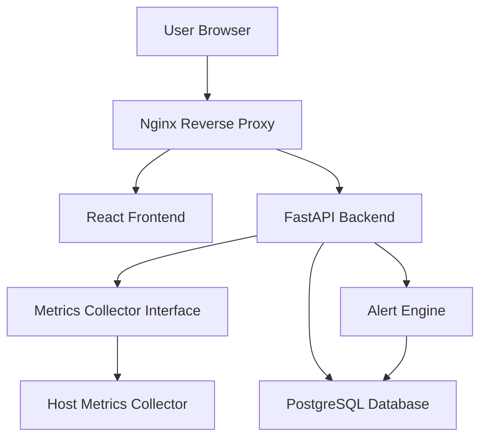

# OpsPulse – System Architecture

**Project:** OpsPulse  
**Version:** 1.0.0  
**Status:** Architecture Design  
**Cloud Provider:** AWS  
**Region:** US East (Ohio)  
**Operating System:** Ubuntu 24.04 LTS

---

## 1. Project Overview

OpsPulse is a Linux server monitoring and observability platform designed to collect, process, store, and visualize server metrics.

The platform provides real-time monitoring, historical metrics, process information, user authentication, and configurable alerts.

## 2. Technology Stack

| Layer | Technology |
|---|---|
| Cloud Infrastructure | AWS EC2 |
| Operating System | Ubuntu 24.04 LTS |
| Containerization | Docker |
| Orchestration | Docker Compose |
| Reverse Proxy | Nginx |
| Backend | Python + FastAPI |
| Frontend | React + TypeScript |
| Database | PostgreSQL |
| Metrics Collection | psutil |
| Charts | Chart.js |
| Authentication | JWT |
| Testing | Pytest |
| CI/CD | GitHub Actions |

## 3. System Components

### Frontend
- Responsive monitoring dashboard.
- CPU, memory, disk and network charts.
- Historical metrics visualization.
- Process monitoring.
- Alert management.
- Authentication interface.

### Backend
- REST API.
- Authentication and authorization.
- Metrics processing.
- Database integration.
- Alert evaluation.
- API validation.

### Metrics Collector
- Collect host CPU utilization.
- Collect memory utilization.
- Collect disk utilization.
- Collect network statistics.
- Collect system uptime.
- Collect process information.

The collector will run with restricted host-level access and communicate with the backend through a controlled interface.

### Database
PostgreSQL will store:
- User accounts.
- Roles and permissions.
- Historical metrics.
- Alert configurations.
- Alert history.
- Audit logs.

### Reverse Proxy
Nginx will:
- Serve the compiled frontend.
- Forward API requests to FastAPI.
- Handle HTTP routing.
- Provide a future integration point for HTTPS.

## 4. High-Level Architecture

## 5. Docker Architecture

The application will initially use three containers:

| Container | Responsibility |
|---|---|
| opspulse-proxy | Nginx and compiled frontend |
| opspulse-api | FastAPI backend |
| opspulse-db | PostgreSQL database |

The host metrics collector will run separately on Ubuntu using a restricted system service.

### Container Networking
- Internal Docker network.
- Database accessible only internally.
- API accessible through reverse proxy.
- Frontend served through Nginx.
- No publicly exposed PostgreSQL port.

### Persistent Storage
PostgreSQL data will use a persistent Docker volume.

Application logs will use controlled rotation.

## 6. Security Architecture

- JWT-based authentication.
- Secure password hashing.
- Environment-based secret management.
- Restricted database access.
- Private Docker networking.
- SSH restricted to authorized IP addresses.
- Least-privilege metrics collection.
- Input validation.
- API rate limiting.
- No secrets committed to Git.

## 7. Resource Management

Initial EC2 configuration:

| Resource | Available |
|---|---|
| vCPU | 2 |
| RAM | Approximately 1 GB |
| Storage | 20 GB |
| Operating System | Ubuntu 24.04 LTS |

Resource optimization:
- Multi-stage frontend build.
- Lightweight production containers.
- Limited PostgreSQL connections.
- Controlled metric collection intervals.
- Database retention policies.
- Container resource monitoring.
- Log rotation.

## 8. Scalability

The application must support future upgrades without major architectural changes.

Potential improvements:
- Separate metrics collector.
- Multiple monitored servers.
- Distributed metrics storage.
- Advanced alert notifications.
- Role-based administration.
- Centralized observability.

## 9. Deployment Strategy

Initial deployment:

AWS EC2 → Ubuntu → Docker Compose → Nginx → FastAPI → PostgreSQL

CI/CD will be implemented using GitHub Actions.

## 10. Project Constraints

- Minimize AWS expenditure.
- Use existing AWS credits.
- Avoid unnecessary paid services.
- Preserve data across container restarts.
- Maintain secure access to the server.
- Optimize for low-memory EC2 instances.
