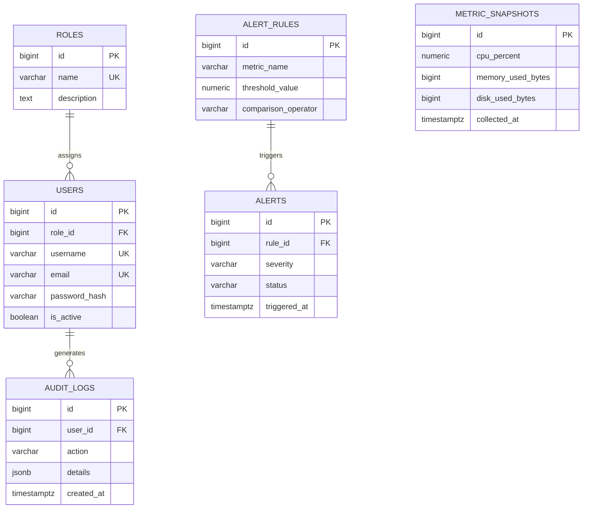

# OpsPulse – Database Architecture

**Version:** 1.0.0  
**Database:** PostgreSQL  
**Status:** Design Phase

## 1. Overview

OpsPulse uses PostgreSQL to store user accounts, permissions, server metrics, alert configurations, alert history and audit events.

The initial schema contains six primary tables.

## 2. Database Tables

### 2.1 roles

Stores application roles.

| Column | Data Type | Constraints |
|---|---|---|
| id | BIGSERIAL | Primary Key |
| name | VARCHAR(50) | Unique, Not Null |
| description | TEXT | Nullable |
| created_at | TIMESTAMPTZ | Not Null, Default NOW() |

Initial roles:
- admin
- operator
- viewer

### 2.2 users

Stores authenticated users.

| Column | Data Type | Constraints |
|---|---|---|
| id | BIGSERIAL | Primary Key |
| role_id | BIGINT | Foreign Key → roles.id |
| username | VARCHAR(100) | Unique, Not Null |
| email | VARCHAR(255) | Unique, Not Null |
| password_hash | VARCHAR(255) | Not Null |
| is_active | BOOLEAN | Default TRUE |
| created_at | TIMESTAMPTZ | Default NOW() |
| updated_at | TIMESTAMPTZ | Default NOW() |

Passwords must be stored as secure password hashes, never plaintext.

### 2.3 metric_snapshots

Stores historical server metrics.

| Column | Data Type | Constraints |
|---|---|---|
| id | BIGSERIAL | Primary Key |
| cpu_percent | NUMERIC(5,2) | Not Null |
| memory_total_bytes | BIGINT | Not Null |
| memory_used_bytes | BIGINT | Not Null |
| memory_percent | NUMERIC(5,2) | Not Null |
| disk_total_bytes | BIGINT | Not Null |
| disk_used_bytes | BIGINT | Not Null |
| disk_percent | NUMERIC(5,2) | Not Null |
| network_bytes_sent | BIGINT | Not Null |
| network_bytes_received | BIGINT | Not Null |
| load_average_1m | NUMERIC(8,2) | Nullable |
| collected_at | TIMESTAMPTZ | Default NOW() |

All percentages must be validated between 0 and 100.

Network values represent cumulative interface counters.

### 2.4 alert_rules

Stores configurable alert thresholds.

| Column | Data Type | Constraints |
|---|---|---|
| id | BIGSERIAL | Primary Key |
| name | VARCHAR(100) | Not Null |
| metric_name | VARCHAR(50) | Not Null |
| threshold_value | NUMERIC(10,2) | Not Null |
| comparison_operator | VARCHAR(10) | Not Null |
| duration_seconds | INTEGER | Default 0 |
| is_enabled | BOOLEAN | Default TRUE |
| created_at | TIMESTAMPTZ | Default NOW() |

Supported metrics:
- cpu_percent
- memory_percent
- disk_percent

### 2.5 alerts

Stores triggered alert events.

| Column | Data Type | Constraints |
|---|---|---|
| id | BIGSERIAL | Primary Key |
| rule_id | BIGINT | Foreign Key → alert_rules.id |
| severity | VARCHAR(20) | Not Null |
| message | TEXT | Not Null |
| status | VARCHAR(20) | Default 'open' |
| triggered_at | TIMESTAMPTZ | Default NOW() |
| resolved_at | TIMESTAMPTZ | Nullable |

Alert statuses:
- open
- acknowledged
- resolved

### 2.6 audit_logs

Stores security and application activity.

| Column | Data Type | Constraints |
|---|---|---|
| id | BIGSERIAL | Primary Key |
| user_id | BIGINT | Nullable, Foreign Key → users.id |
| action | VARCHAR(100) | Not Null |
| resource_type | VARCHAR(100) | Nullable |
| resource_id | VARCHAR(100) | Nullable |
| ip_address | INET | Nullable |
| details | JSONB | Nullable |
| created_at | TIMESTAMPTZ | Default NOW() |

Audit records should be append-only for application users.

## 3. Entity Relationship Diagram

## 4. Relationships

1. One role can have multiple users.
2. One user can generate multiple audit logs.
3. One alert rule can trigger multiple alerts.
4. Metric snapshots are independent time-series records.
5. Audit logs may have a NULL user_id for system-generated events.

## 5. Indexing Strategy

Create indexes on:

| Table | Index |
|---|---|
| users | username |
| users | email |
| metric_snapshots | collected_at |
| alerts | status |
| alerts | triggered_at |
| alerts | rule_id |
| audit_logs | user_id |
| audit_logs | created_at |

Unique constraints on usernames and emails already create supporting indexes.

## 6. Data Retention

Initial retention policy:

| Data | Retention |
|---|---|
| Metric snapshots | 7 days |
| Alerts | 90 days |
| Audit logs | 90 days |
| User accounts | Until deletion |

Retention must be enforced through scheduled maintenance.

## 7. Database Security

- PostgreSQL must not expose port 5432 publicly.
- Use a dedicated application database user.
- Use environment variables for credentials.
- Apply least-privilege database permissions.
- Validate all input through the backend.
- Use parameterized database queries.
- Keep database backups outside the container lifecycle.

## 8. Performance Considerations

- Use connection pooling.
- Limit database connections.
- Index timestamp queries.
- Avoid excessive metric collection frequency.
- Implement retention cleanup.
- Monitor database storage growth.

## 9. Future Improvements

- Multi-server monitoring.
- Server inventory table.
- Metric aggregation.
- Alert notification history.
- Database partitioning for larger deployments.
