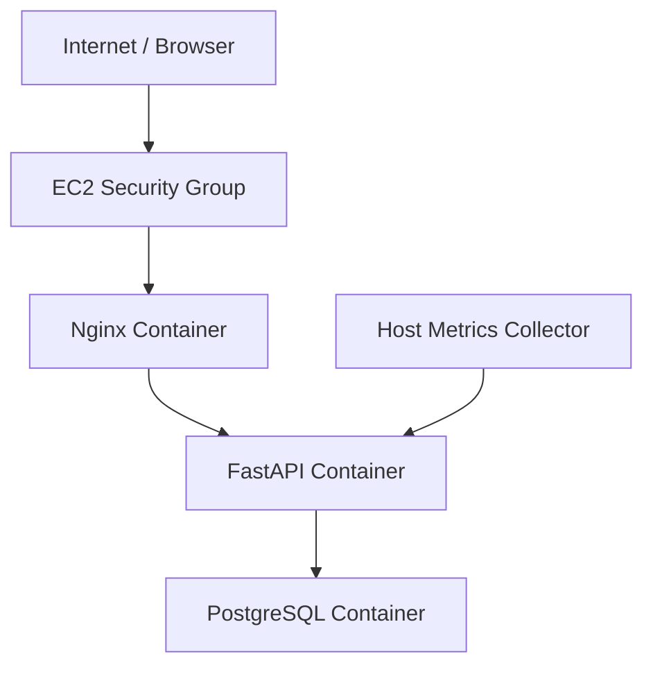
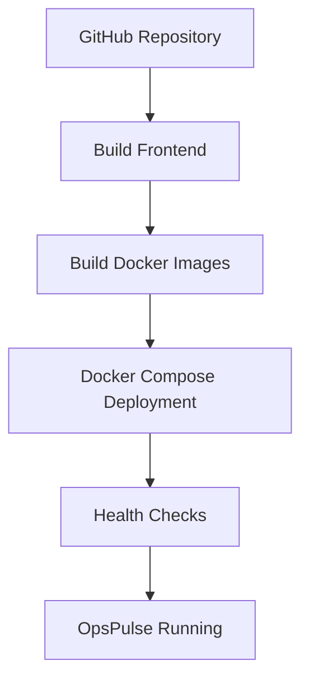

# OpsPulse – Docker Architecture

**Project:** OpsPulse  
**Version:** 1.0.0  
**Orchestration:** Docker Compose  
**Environment:** AWS EC2 – Ubuntu 24.04 LTS  
**Status:** Design Phase

---

## 1. Overview

OpsPulse will use Docker Compose to manage its application services.

The deployment will use three primary containers:

1. Nginx – Frontend hosting and reverse proxy.
2. FastAPI – Backend application.
3. PostgreSQL – Persistent database.

The React frontend will be compiled into static files and served by Nginx. A separate Node.js production container is not required.

The host metrics collector will run as a restricted Ubuntu system service.

## 2. Container Architecture

| Container | Image | Responsibility |
|---|---|---|
| opspulse-proxy | Custom Nginx | Frontend and API reverse proxy |
| opspulse-api | Custom Python | FastAPI application |
| opspulse-db | PostgreSQL | Persistent database |

## 3. Container Communication

The application will use a private Docker bridge network named:

`opspulse-network`

Communication:

- Nginx communicates with FastAPI.
- FastAPI communicates with PostgreSQL.
- PostgreSQL is not directly accessible from the public network.
- Only the reverse proxy exposes the application HTTP port.

## 4. Network Architecture

## 5. Persistent Storage

A named Docker volume will store PostgreSQL data.

Volume:

`opspulse-postgres-data`

Requirements:
- Database data must survive container restarts.
- Database data must survive container replacement.
- Database files must not be stored inside the container writable layer.
- Backups must be created separately.
- Backup retention must be controlled.

## 6. Environment Configuration

Application configuration will use environment variables.

Examples:

| Variable | Purpose |
|---|---|
| APP_ENV | Application environment |
| APP_SECRET_KEY | Application signing secret |
| DATABASE_URL | PostgreSQL connection URL |
| POSTGRES_DB | Database name |
| POSTGRES_USER | Database username |
| POSTGRES_PASSWORD | Database password |
| ACCESS_TOKEN_EXPIRE_MINUTES | JWT expiration |

Security requirements:
- Never commit `.env` files.
- Maintain `.env.example` without real credentials.
- Use strong randomly generated secrets.
- Restrict file permissions.
- Rotate credentials when necessary.

## 7. Health Checks

Each service must expose or provide an appropriate health check.

| Service | Health check |
|---|---|
| Nginx | HTTP response |
| FastAPI | `/api/health` |
| PostgreSQL | `pg_isready` |

Application readiness must be distinguished from basic container startup.

## 8. Restart Policies

Production containers should use an appropriate restart policy.

Expected behavior:
- Recover after unexpected process failure.
- Restart after EC2 reboot when Docker starts.
- Avoid uncontrolled restart loops.
- Preserve database data during recovery.

## 9. Resource Management

The initial EC2 server has approximately 1 GB RAM and 2 vCPUs.

Resource allocation must leave sufficient memory for Ubuntu and the Docker daemon.

Initial planning targets:

| Component | Memory target |
|---|---|
| Ubuntu + Docker daemon | 350–450 MB |
| PostgreSQL | 150–200 MB |
| FastAPI | 100–150 MB |
| Nginx | 30–50 MB |
| Safety headroom | Remaining memory |

These are provisional planning targets, not guaranteed limits. Actual consumption must be measured before enforcing container memory limits.

Additional requirements:
- Avoid running multiple API workers initially.
- Limit PostgreSQL connections.
- Avoid memory-heavy build processes on EC2.
- Build the React frontend outside the production runtime.
- Monitor CPU and RAM usage.

## 10. Container Security

- Run application containers as non-root users where practical.
- Do not use privileged containers.
- Avoid mounting the Docker socket.
- Keep PostgreSQL on the internal network.
- Expose only required ports.
- Use minimal base images.
- Pin dependency and image versions.
- Apply security updates.
- Store secrets outside version control.

The metrics collector must use a restricted host interface rather than unrestricted container privileges.

## 11. Logging

Requirements:
- Capture container standard output and standard error.
- Configure log rotation.
- Avoid unlimited log growth.
- Never log passwords or access tokens.
- Record application errors and security events.

## 12. Deployment Lifecycle

## 13. Backup and Recovery

- Use PostgreSQL logical backups.
- Store backups outside the database container.
- Test database restoration.
- Never treat a Docker volume as a backup.
- Define recovery procedures before production use.

## 14. Future Scalability

The architecture should support:
- Increasing container resources.
- Separating the metrics collector.
- Multiple monitored servers.
- External PostgreSQL hosting.
- Dedicated metrics storage.
- Automated deployment.

## 15. Deployment Constraints

- Minimize AWS credit consumption.
- Avoid unnecessary AWS services.
- Do not expose database ports publicly.
- Preserve application data.
- Monitor EC2 memory consumption.
- Keep the deployment reproducible.
